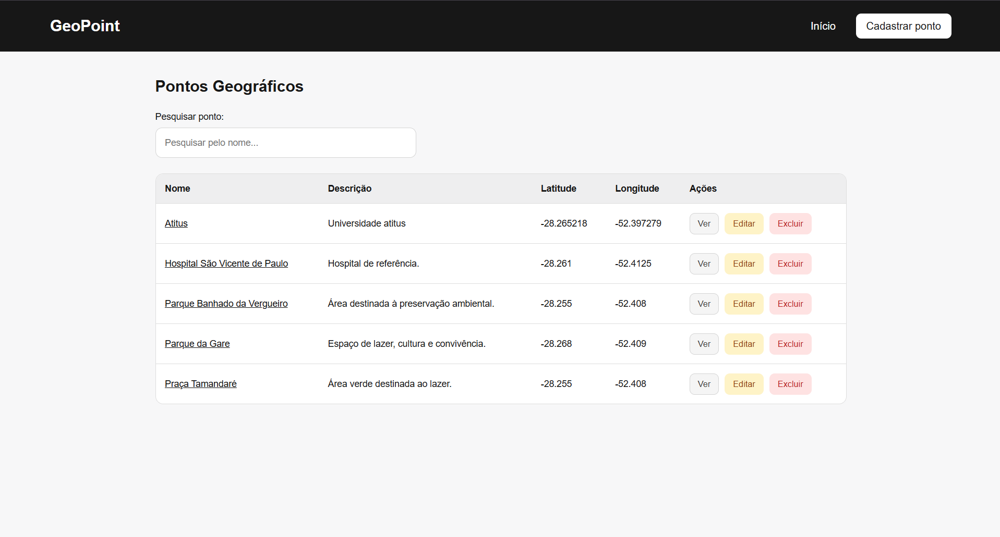
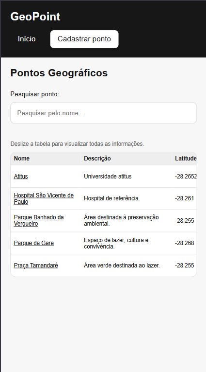
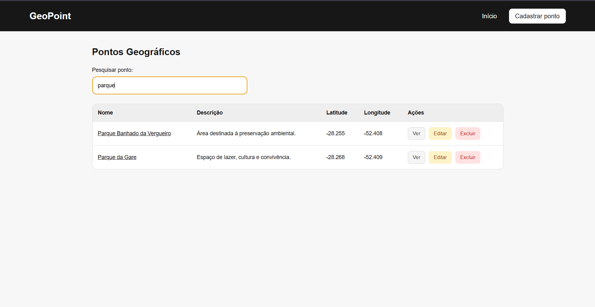
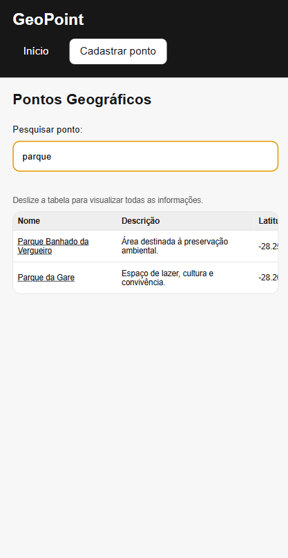
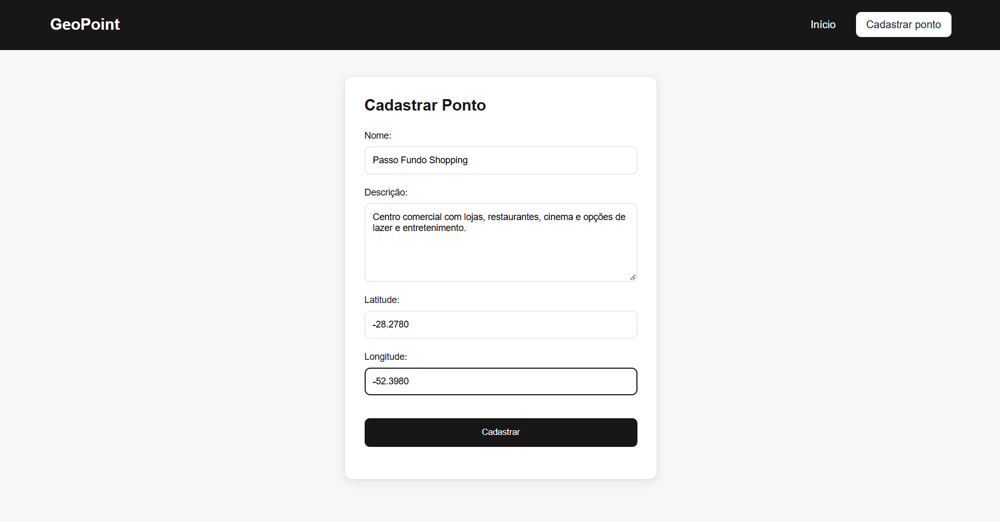
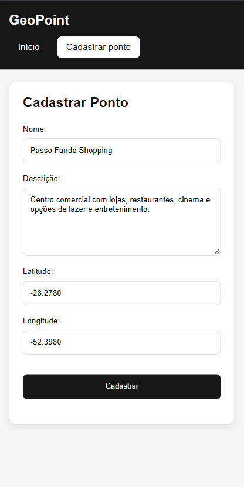
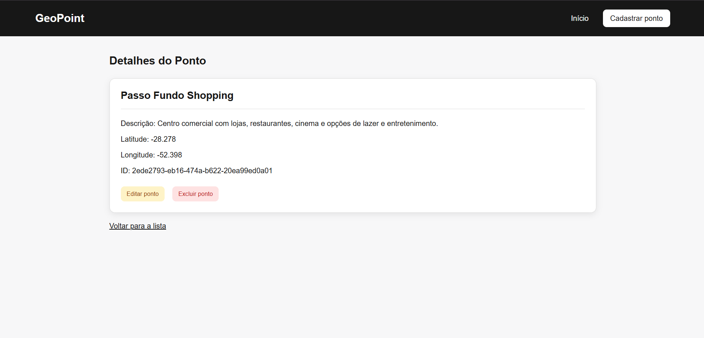
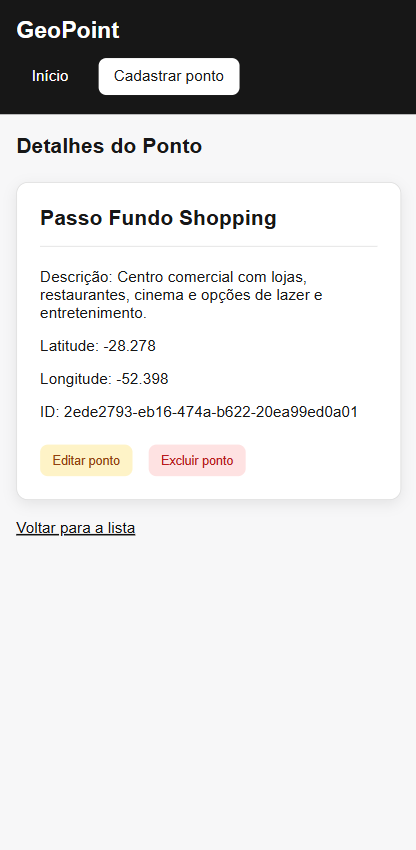
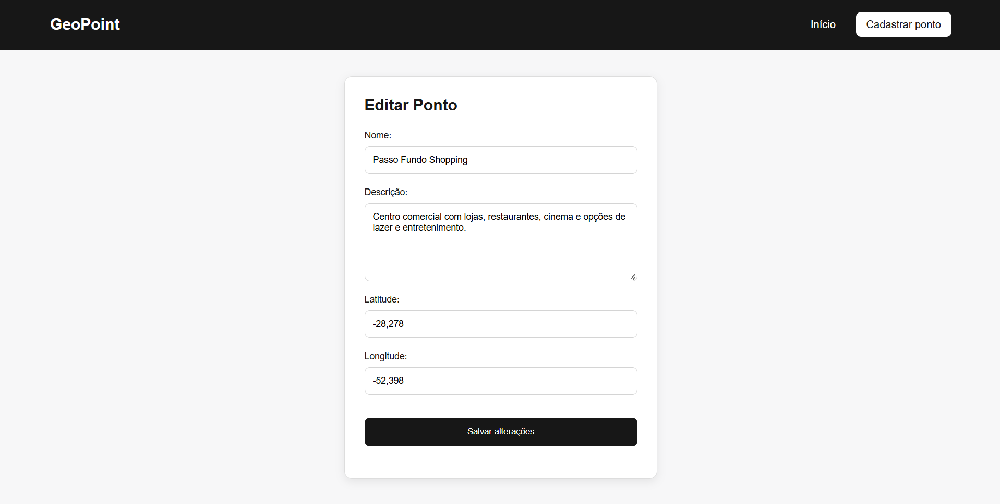
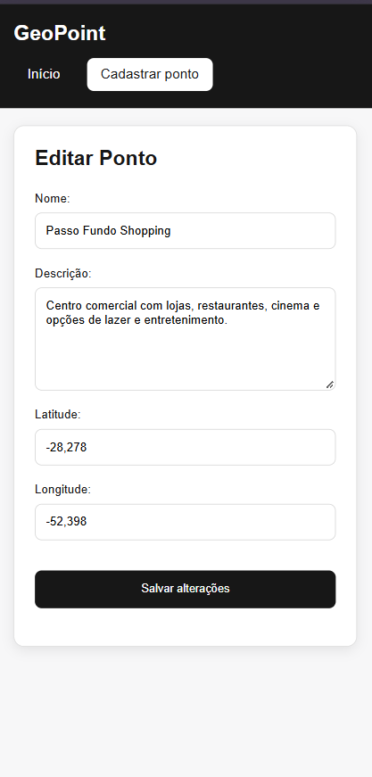

# Trabalho G2 — CRUD de Pontos Geográficos

## GeoPoint

## Aluna: 
Isadora Severo Sacomori

## RA:
1139246

## Link do Drive:
https://drive.google.com/file/d/1apkG2etU4WiGiQdaxGpaZXabyH2HyKPU/view?usp=sharing

## Tecnologia escolhida:
HTML, CSS e JavaScript puro.

## Como rodar o projeto:

1. Clone o repositório;
2. Abra a pasta do projeto no Visual Studio Code;
3. Abra o arquivo index.html em um navegador;
4. Utilize o sistema normalmente.

Obs: é necessário ter conexão com a internet para acessar a API pelo navegador.

## URL da API utilizada:

https://geopoint-6x4u.onrender.com

## Prints das telas:

### Listagem

| Desktop | Mobile |
| :---: | :---: |
|  |  |

### Filtro

| Desktop | Mobile |
| :---: | :---: |
|  |  |

### Cadastro

| Desktop | Mobile |
| :---: | :---: |
|  |  |

### Detalhe

| Desktop | Mobile |
| :---: | :---: |
|  |  |

### Edição

| Desktop | Mobile |
| :---: | :---: |
|  |  |
